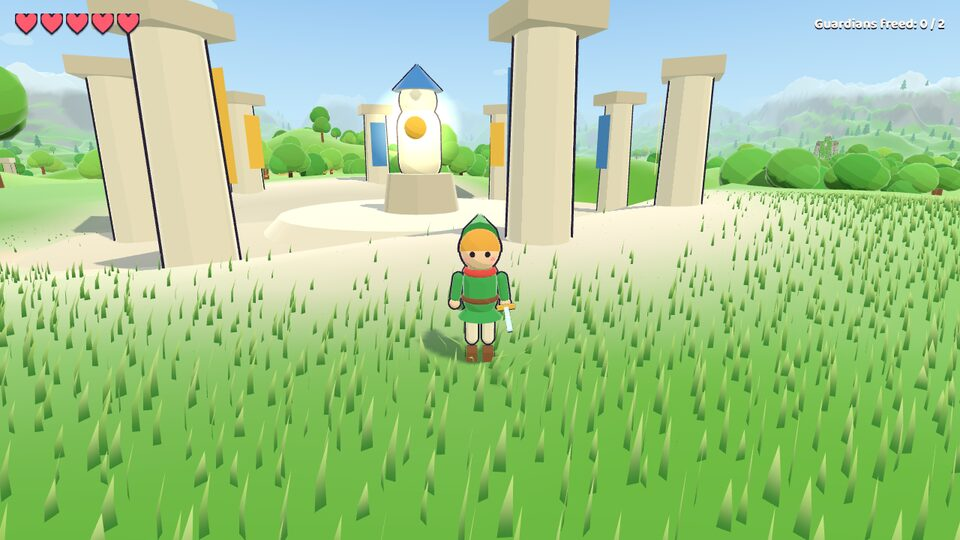
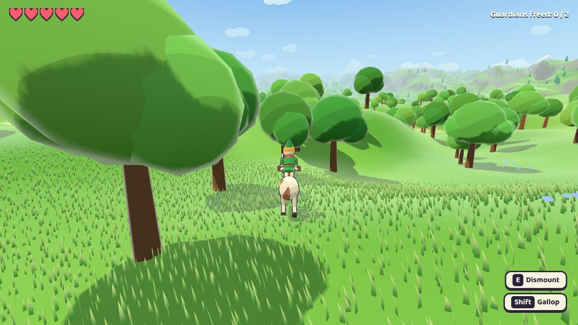
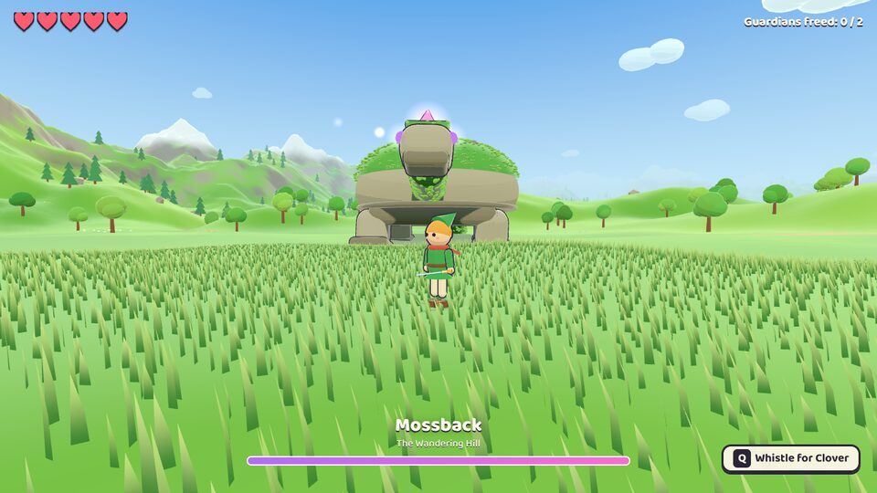
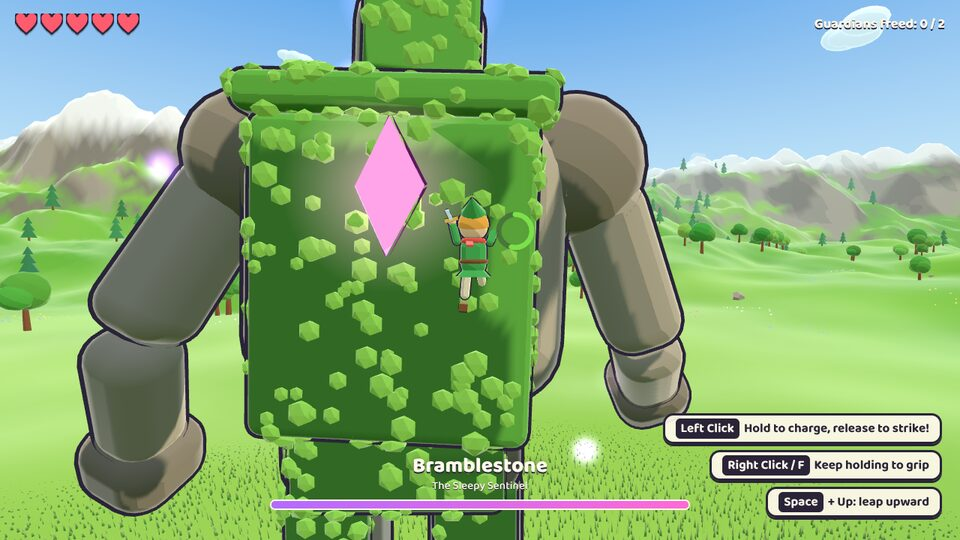

# Colossi: Gentle Giants

A small three.js adventure where **the boss is the dungeon**. Ride your pony across a bright, cel-shaded valley, find the
sleepy stone guardians, climb their mossy bodies, and purify the glowing gloom crystals to set them free. The gameplay is
modelled on *Shadow of the Colossus*; the look and tone aim for a child-friendly, *Breath of the Wild*-style storybook world.



| Riding Clover | Mossback, the Wandering Hill | Climbing Bramblestone |
| --- | --- | --- |
|  |  |  |

## Run it

```bash
npm install
npm run dev      # open the printed URL, click Play
npm run build    # static build in dist/ (relative paths, host anywhere)
```

URL flags: `?low` lowers pixel ratio and grass density, `?debug` shows an FPS counter.

## Controls

| Action | Keyboard / mouse | Gamepad |
| --- | --- | --- |
| Move / look | WASD / mouse | Left stick / right stick |
| Jump, leap while climbing (hold Up + Jump) | Space | A |
| Run / gallop | Shift | B |
| Grip (hold) | Right click or F | RB / RT |
| Charge (hold) and strike (release) | Left click | X |
| Ride / dismount | E | Y |
| Whistle for your pony | Q | D-pad |
| Raise sword: its light points to the nearest guardian | R | LT |
| Look at the guardian | Tab or middle click | LB |
| Pause / mute | Esc / M | Start |

Movement and climbing are camera-relative: "forward" always means away from the camera, including when you climb down
the far side of a shoulder or shell.

## How it plays

- **Moss is grippable, stone is not.** Hold grip to cling to moss; you can stand on any flat surface, stone included.
  Gripping on steep surfaces drains the stamina wheel. When it runs out you let go.
- **Guardians shake.** If you are standing on one without gripping when it shakes, you get thrown off.
- **Crystals are weak points.** Get within reach, hold to charge, and release. A fully charged strike does about five
  times the damage of a tap. Purify every crystal to free the guardian; it kneels and the meadow around it blooms.
- **Hearts.** Stomps, bubbles, and long falls cost hearts. At zero you take a short rest and wake up at the last safe spot.
  Guardians keep their damage.

### The guardians

- **Bramblestone, the Sleepy Sentinel** (biped, about 22 m tall). Furry moss runs up the backs of its legs, its belt, its
  back, its shoulders, and the back of its head. Crystals: left calf (it falls to one knee), upper back, and top of head.
  It slowly turns to face you and stomps when you stand near its feet; it turns much more slowly when you are right below
  it, so sneak behind.
- **Mossback, the Wandering Hill** (giant tortoise). The shell's overhang can't be climbed from the ground; walk up its
  wide, swishing tail instead. Crystals: top of the shell and top of the head (reach it along the mossy neck). It spits
  homing gloom bubbles from range, rears up and slams when you're in front of it, and bucks while you ride its shell.

## Code tour

```
src/
  main.js              Game setup, loop, menus, beam, prompts, freeing sequence
  input.js             Keyboard, mouse (pointer lock with fallback), and gamepad mapped to named actions
  camera.js            Third-person orbit camera with focus-on-guardian, shake, and gallop FOV kick
  player.js            Hero controller: ground, air, swim, ride, and the surface-climbing system
  horse.js             Clover the pony: whistle-to-call, camera-relative steering, gallop, jump
  colossus/Colossus.js Shared guardian rules: moss parts, crystals, shaking, body collision, being freed
  colossus/golem.js    Bramblestone: build, procedural walk/stomp/kneel animation, AI
  colossus/turtle.js   Mossback: build, rear-up/slam, tail flick, bubble projectiles, AI
  world/terrain.js     Heightfield valley (seeded simplex noise) with flattened arenas, paths, and lakes
  world/grass.js       GPU grass: a scrolling grid of blades that samples the terrain height texture
  world/props.js       Instanced trees, pines, rocks, flowers, clouds, the shrine, and ruins
  world/sky.js         Gradient sky dome and toon water with shoreline foam
  materials.js         Toon materials, rim light, inverted-hull outlines, glow sprites
  effects.js, audio.js Particles, shockwave rings, and a tiny WebAudio synth (no audio files)
```

### Climbing in one paragraph

While attached, the hero stores a point and a normal in the **local space of the body part** they are holding, so they
ride along with every animation. Each step casts a few short rays against the guardian's collision meshes: a chest-height
"reach" for moss in front, a "wall" ray for concave corners, a "snap" ray from outside the surface (horizontal on walls,
so rounded edges can't bounce you back down), and a "wrap" ray around convex edges. Standing versus hanging uses
hysteresis on the surface normal, and a headroom check stops you from stepping into overlapping geometry.

### Adding a guardian

Subclass `Colossus`, build parts with `this.part(...)` (stone) and `this.moss(...)` (climbable), add weak points with
`this.crystal(...)`, add ground-collision capsules with `this.capsule(...)`, and implement `place(terrain)`,
`update(dt)` (call `this.updateCommon(dt)`), and `animate(dt)`. Register it in `main.js` and give it an arena in
`world/layout.js`.

## Tests

The tests drive the real game in headless Chromium, stepping the simulation directly (software WebGL is too slow to
play in real time).

```bash
npm test   # routes + flows + smoke
```

- `scripts/routes.mjs` climbs both guardians with scripted input and checks every crystal is reachable and strikes land.
- `scripts/flows.mjs` checks stomps, bubbles, knockout and respawn, swimming, whistling, and fall damage.
- `scripts/smoke.mjs` boots the game, rides, climbs, frees both guardians, and saves screenshots to `screenshots/`.

They look for Chromium under `/opt/pw-browsers`; set `CHROME_PATH` to use another build.

## Known limitations

- Performance has only been measured in headless software rendering, not on a real GPU. If it stutters, try `?low`.
- No touch controls yet; keyboard and mouse or a gamepad is required.
- Two guardians so far. The base class is built for more.
